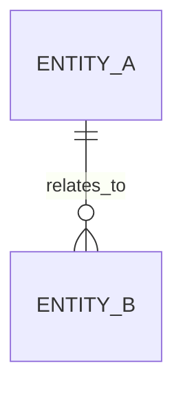
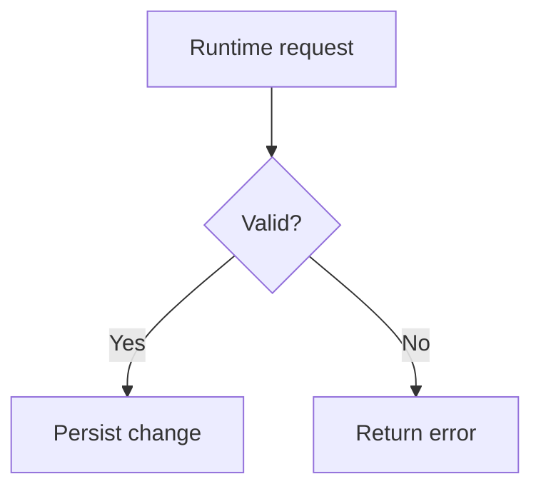
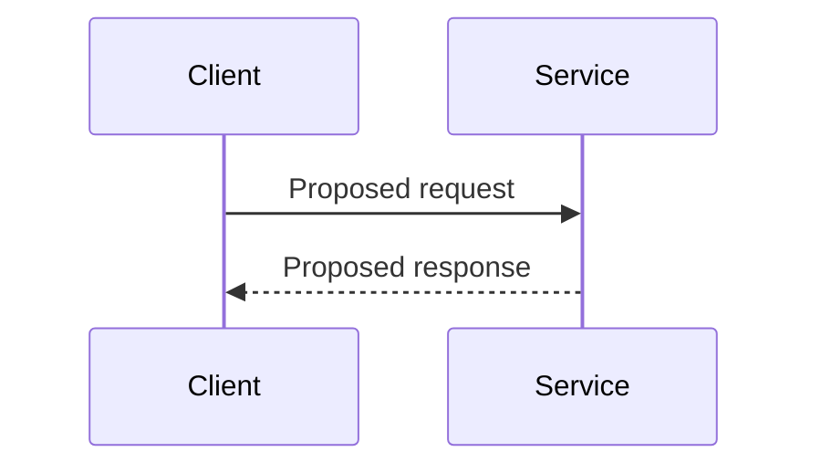

# Plan Ticket

## Goal

Turn an existing Jira ticket into a clear, actionable implementation plan based on the current Tutor Marketplace knowledge base, source code, database state, and relevant project context.

This skill focuses on **how the approved requirement can be implemented**. It does not change the requirement, implement the solution, or silently resolve product decisions that remain TBD.

The final plan must be understandable by a developer who will implement the ticket without needing the conversation that produced the plan.

## Invocation

Use this skill when the user explicitly invokes `$plan-ticket` or clearly asks to plan, analyze, break down, or prepare implementation for an existing Tutor Marketplace Jira ticket.

Example:

`$plan-ticket KAN-123`

The Jira issue key identifies the ticket to plan. Additional text supplied by the user is additional planning context, but it must not override confirmed project knowledge unless the user is explicitly making a project decision.

Explicit invocation selects this workflow but is not approval to write anything to Jira.

## Core planning principle

`create-ticket` defines **WHAT + WHY + SUCCESS CONDITIONS**.

`plan-ticket` defines **HOW the confirmed requirement can be implemented**.

Planning may include technical details when they are supported by the current project state, such as:
- affected modules or repositories
- expected files or components to change
- backend/frontend/database responsibilities
- API or data-flow changes
- migrations when relevant
- dependencies and sequencing
- validation and testing approach

Do not invent business rules, API contracts, database schema, or product decisions merely to make the plan complete.

## Specificity standard — implementation-ready solution

A plan must be a **proposed technical solution**, not a list of activities to investigate, decide, design, implement, and verify. Before writing it, inspect the relevant real repository files, Jira acceptance criteria, and KB, and convert confirmed requirements into a concrete, testable design.

The developer reading the plan must be able to answer **what objects or components to create/change, where, how they connect, which constraints and algorithms apply, and exactly how to validate them** without redoing architectural research.

**Required specificity when relevant:**
- **Database:** propose named tables with purpose, columns/types/nullability/defaults, PK/FK/unique/check constraints, indexes (including partial indexes), relations and cardinality, enum/reference representation, migration names/order, seed data, transaction boundaries, and representative SQL DDL. Include a Mermaid `erDiagram` for nontrivial schema changes. Show concrete positive and negative SQL checks.
- **Backend:** identify precise repo/module/package/file paths based on inspected code; proposed controllers, endpoints/methods, request/response shapes, services, repositories, DTOs, validation, authorization, state transitions, error handling and transaction boundaries. Include focused code/pseudocode for complex logic when useful.
- **Frontend:** name real or proposed feature routes, components, services, models, API calls, data/UX states, form validation and error handling.
- **Infrastructure/integrations:** specify config keys, environment dependencies, execution commands, failure/retry behavior and observable verification.
- **All tickets:** include a file-by-file change list, ordered build steps with tangible deliverables, and explicit acceptance-criteria-to-test mapping where available.

**Concrete proposal vs confirmed fact:** Distinguish `Existing (verified)`, `Proposed (not yet approved)`, and `Blocked/TBD`. A well-identified proposed table/API/file is allowed and expected as a recommendation, even when it is not currently in the code or KB. Never represent it as already confirmed or implemented. Do not assert that a product choice has been approved. Ground choices in requirements and architecture, explain concise tradeoffs, and flag assumptions.

**Decision discipline:** Make reversible technical recommendations where requirements permit; do not put every technology/data-type choice into Open Decisions. Reserve Open Decisions for truly product-defining, security-sensitive, or materially blocking unknowns. For each blocker give 2–3 feasible choices, a recommended default if justified, and the exact plan portion contingent on the decision. If a blocker prevents finalizing one part, still give a detailed conditional implementation for the rest. Never invent a confirmed business rule.

**Avoid generic wording:** Prohibited as standalone plan steps: "define schema", "decide representation", "implement migrations", "add validation", "update documentation", or "test constraints" without specifying the actual artifacts, structures, rules, and checks. Merely restating the Jira ticket in more words is not a solution. Do not fill diagrams with project-management actions (inspect, approve, document); diagram the proposed **runtime/data behavior or database relationships** instead.

**No ungrounded precision:** If source code, live database, or ticket details cannot be accessed, clearly identify what is unverified, avoid falsely claiming inspection, and give an explicitly provisional proposal using available evidence rather than substituting a long generic checklist. Do not claim a plan is implementation-ready if critical inputs are missing.

## Context gathering

Before producing the plan:

1. Read the Jira ticket through Atlassian MCP, including its description, acceptance criteria, current status, and relevant existing comments.
2. Read relevant confirmed knowledge from `tutor_kb` through GitHub MCP.
3. Inspect `tutor_backend` when backend behavior or current implementation matters.
4. Inspect `tutor_frontend` when frontend behavior or current implementation matters.
5. Inspect Supabase when the current database state materially affects the plan.
6. Inspect related Jira work when dependencies, duplication, or sequencing matters.
7. Use OpenAI Developer Docs only when the ticket concerns OpenAI/Codex functionality and current official behavior matters.

Gather only context relevant to the ticket. Do not inspect unrelated systems merely because they are available.

Inspect the actual file tree and relevant implementation files, not just high-level READMEs. Record the exact inspected paths and avoid guessing that a file exists. For proposed new paths, label them explicitly as new. If an essential source is inaccessible, identify that gap in the plan rather than pretending it was verified.

## Knowledge handling

Treat project knowledge literally:

- **Confirmed** — may be relied upon when planning.
- **Planned** — may be considered as intended direction, but do not describe it as already implemented.
- **TBD** — unresolved and must not be silently decided.

If a TBD or missing decision materially affects implementation, list it under **Open Decisions**.

Do not modify the Jira requirement to fit the current code. If the ticket conflicts with confirmed project knowledge, clearly identify the conflict in the plan.

## Required plan structure

Use the following sections when relevant.

### 1. Goal

Briefly summarize the implementation outcome required by the Jira ticket.

Do not rewrite the entire ticket.

### 2. Affected Areas

List only project areas that are expected to change or require coordination.

Examples:
- Backend
- Frontend
- Database
- Knowledge Base
- Infrastructure
- Agent workflow

When useful, mention relevant modules, packages, components, or files discovered from the current source code.

### 3. Proposed Technical Solution

Present the recommended target design **before** the execution steps. Specify actual proposed structures and interfaces: a schema/table-and-column specification, API contract, component/service interaction, or configuration design, whichever applies. Where relevant include concise SQL, JSON, or pseudocode snippets (not a full code implementation). Label new or unverified details as proposals and identify which existing paths were verified.

For database tasks, include an **Entity Relationship Diagram** in Mermaid `erDiagram` when more than one related table is involved, plus concrete constraint/index/relationship specifications and representative SQL DDL. For other tasks, choose technical artifacts appropriate to the domain. Avoid diagramming a process of gathering approvals as the technical solution.

### 4. File-by-file Changes

List each confirmed existing or proposed new file/path, what changes in it, and its responsibility. Prioritize file-level guidance a developer can follow. Explicitly distinguish **existing (verified)** from **new (proposed)** paths.

### 5. Implementation Steps

Provide an ordered implementation sequence tied to the proposed design and files above.

Rules:
- Steps must be concrete enough for a developer to execute.
- Keep the plan at implementation level rather than writing the actual code.
- Respect existing project architecture and conventions.
- Identify cross-repository or cross-layer sequencing when relevant.
- Do not add unrelated refactoring or improvements.

### 6. Flowchart

When the ticket has meaningful processing logic, decision branches, or multi-step behavior, include a Mermaid `flowchart` to explain the proposed execution flow.

Rules:
- Show **runtime/data processing**, branches, invariants, and failure paths; not the project-management process of planning, approval, coding, or documentation.
- Represent the business/process flow at a useful level of abstraction, not every method call.
- Label branches and failure paths when they matter to the acceptance criteria.
- Base nodes and transitions on confirmed requirements and inspected context.
- Do not invent business rules, APIs, tables, or implementation details.
- Mark unresolved behavior as `TBD` and describe the corresponding question under **Open Decisions**.
- Omit this section if the ticket does not benefit from a flowchart.

### 7. Sequence Diagram

When the ticket involves meaningful interactions across actors, components, services, repositories, or the database, include a Mermaid `sequenceDiagram` showing the order of those interactions.

Rules:
- Illustrate the proposed runtime or migration interaction; do not show a documentation workflow unless that itself is the ticket subject.
- Use participants grounded in the project architecture or code actually inspected, or clearly labeled proposed components.
- Show key requests, responses, and important alternative/error paths when supported.
- Do not imply a new API contract, endpoint, service boundary, or database operation is approved when it is not.
- Use conceptual labels rather than invented concrete interfaces where necessary.
- Mark unresolved interactions as `TBD` and include the related decision under **Open Decisions**.
- Omit this section when there is no meaningful interaction sequence (for example, a simple documentation change).

### Diagram standards

- Use fenced Mermaid code blocks (```mermaid) for diagrams, including ERDs when applicable.
- Keep diagrams concise, legible, and consistent with **Plan** and **Validation**.
- Do not include generic placeholder diagrams merely to fill a section.
- The Jira comment must preserve the Mermaid source in fenced code blocks. Do not assume the Jira instance renders Mermaid natively; users should still be able to copy the source to a Mermaid-compatible viewer.
- If the Jira comment format cannot preserve Mermaid code fences, preserve the source as clearly labelled preformatted/code text instead; do not silently discard diagrams.

### 8. Validation

Describe how the implementation should be verified against the ticket's acceptance criteria.

Include relevant tests, integration checks, migration checks, or manual validation only when applicable.

Do not invent acceptance criteria that are not present in the ticket or confirmed project knowledge.

For each applicable acceptance criterion, provide a specific test case with setup/input, expected outcome, and an executable test command or sample SQL/assertion where possible. Include negative/boundary cases for constraints and security behavior; specify what failure should occur.

### 9. Dependencies

Include this section only when the ticket depends on other tickets, decisions, systems, migrations, or project work.

Do not invent dependencies merely to populate the section.

### 10. Open Decisions

Include this section only when unresolved decisions materially affect implementation.

Rules:
- Keep the list short and blocker-focused; do not use it as a substitute for producing a technical design.
- For each significant open choice give options, a reasoned recommendation, and precise impacts on the proposed design; make no claim that the recommendation was approved.
- Phrase each item clearly as a decision/question.
- Do not resolve TBD items by guessing.
- Separate product decisions from implementation choices when useful.

If there are no relevant open decisions, omit the section.

## Actions this skill must NOT perform during planning

Generating the implementation plan is read-only work.

Do not, as part of planning:
- modify source code
- create or edit files
- commit or push Git changes
- create, edit, transition, or otherwise modify Jira issues
- post the Jira comment before approval
- execute database mutations or migrations
- modify the knowledge base or configuration

If the user later asks to perform one of these actions, follow the repository's write-action approval rules.

## Jira comment workflow

After the implementation plan is complete:

1. Present the complete plan to the user first.
2. Do not post it to Jira yet.
3. Ask the user directly for explicit approval to post the plan as a comment on the target Jira ticket.
4. Only after explicit approval, post the implementation plan as a Jira comment through Atlassian MCP.
5. Confirm that the comment was posted and identify the Jira issue.

Use a direct approval question such as:

`Do you approve posting this implementation plan as a comment on KAN-123?`

Invocation of `$plan-ticket`, a request to plan a ticket, or approval of the Jira ticket itself does not count as approval to post the comment.

If the plan changes materially after the user approves it but before it is posted, show the revised plan and obtain approval again.

## Draft output format

Present the proposed implementation solution in the following shape (omit conditional sections if they provide no value):

````markdown
## Implementation Plan — <Jira Issue Key>: <Ticket Title>

### Goal
<Concrete outcome>

### Evidence & Assumptions
- Existing (verified): <repo/path and finding>
- Proposed: <new design choice, with short rationale>
- Unverified/TBD: <only material gaps>

### Affected Areas
- <Relevant area>

### Proposed Technical Solution
<Specific table/column/constraint/index designs, API contracts, service/component logic, configuration, or other implementation-level solution>

```sql
-- Representative, grounded proposed DDL or verification query when relevant
```



### File-by-file Changes
| Path | Existing / New | Concrete change |
| --- | --- | --- |
| <repo/path> | <Verified existing / Proposed new> | <Specific artifact and responsibility> |

### Implementation Steps
1. <Exact build step tied to files/design>
2. <Exact build step tied to files/design>

### Flowchart


### Sequence Diagram


### Validation
- <Acceptance criterion> → <test input/command/SQL> → <expected output or failure>

### Dependencies
- <Actual dependency only>

### Open Decisions
- <Blocking choice, feasible options, recommended default and impact>
````

All SQL/ERD/flow/sequence fragments above are syntax-only examples, not facts about Tutor Marketplace. Replace every placeholder with the actual ticket-grounded design; omit irrelevant snippets/sections. Do not output generic template nodes or headings without technical content.

Diagrams are conditional: use an ERD for meaningful relational schema design, a flowchart for runtime/control flow, and a sequence diagram for meaningful component interactions. The Jira comment must preserve the complete approved plan (including diagrams), without the approval conversation or internal research notes.

## Approval rule

Reading Jira, KB, source code, database state, and documentation; analyzing the ticket; and drafting the plan are read-only actions and do not require approval.

Posting the plan as a Jira comment is a write action and requires explicit user approval.

The approval is scoped only to posting the plan that the user has reviewed. It does not authorize code changes, database changes, Jira transitions, commits, pushes, or other write actions.

## Final quality check

Before presenting the plan, verify:

- The plan is based on the actual Jira ticket.
- Relevant project context has been checked.
- The plan follows confirmed architecture and project conventions.
- Planned/TBD knowledge has not been presented as current confirmed state.
- Proposed technical structures, types/contracts/constraints, files, and key algorithms are specified concretely enough to implement; no generic research-only plan passes.
- File-by-file changes identify existing verified vs newly proposed paths.
- For meaningful DB schema work, an ER diagram and specific schema/DDL examples are included.
- Diagrams describe the solution/runtime rather than a project-management approval workflow.
- No unsupported business rule, schema, API contract, or dependency has been invented.
- Validation maps back to the ticket's requirements and acceptance criteria.
- Any Mermaid Flowchart or Sequence Diagram is useful, syntactically coherent, consistent with the implementation steps, and free of invented requirements.
- Open decisions are visible instead of silently resolved.
- No write action has occurred during planning.
- The user will see the complete plan before being asked to approve the Jira comment.
