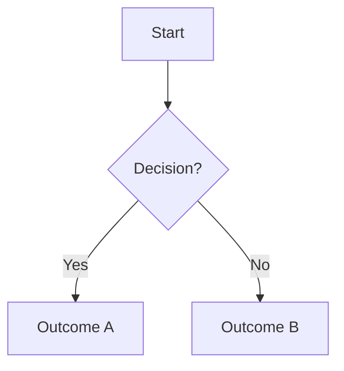
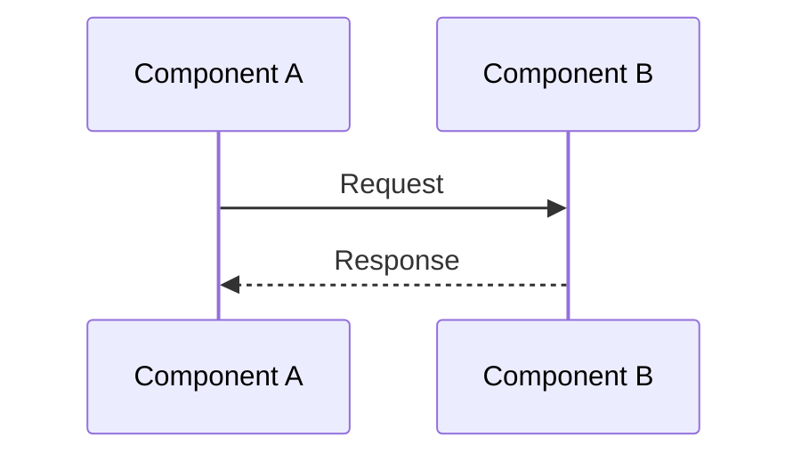

# Plan Ticket

## Goal

Turn an existing Jira ticket into a clear, actionable implementation plan based on the current Tutor Marketplace knowledge base, source code, database state, and relevant project context.

This skill focuses on **how the approved requirement can be implemented**. It does not change the requirement, implement the solution, or silently resolve product decisions that remain TBD.

The final plan must be understandable by a developer who will implement the ticket without needing the conversation that produced the plan.

## Invocation

Use this skill when the user explicitly invokes `$plan-ticket` or clearly asks to plan, analyze, break down, or prepare implementation for an existing Tutor Marketplace Jira ticket.

Example:

`$plan-ticket KAN-123`

The Jira issue key identifies the ticket to plan. Additional text supplied by the user is additional planning context, but it must not override confirmed project knowledge unless the user is explicitly making a project decision.

Explicit invocation selects this workflow but is not approval to write anything to Jira.

## Core planning principle

`create-ticket` defines **WHAT + WHY + SUCCESS CONDITIONS**.

`plan-ticket` defines **HOW the confirmed requirement can be implemented**.

Planning may include technical details when they are supported by the current project state, such as:
- affected modules or repositories
- expected files or components to change
- backend/frontend/database responsibilities
- API or data-flow changes
- migrations when relevant
- dependencies and sequencing
- validation and testing approach

Do not invent business rules, API contracts, database schema, or product decisions merely to make the plan complete.

## Context gathering

Before producing the plan:

1. Read the Jira ticket through Atlassian MCP, including its description, acceptance criteria, current status, and relevant existing comments.
2. Read relevant confirmed knowledge from `tutor_kb` through GitHub MCP.
3. Inspect `tutor_backend` when backend behavior or current implementation matters.
4. Inspect `tutor_frontend` when frontend behavior or current implementation matters.
5. Inspect Supabase when the current database state materially affects the plan.
6. Inspect related Jira work when dependencies, duplication, or sequencing matters.
7. Use OpenAI Developer Docs only when the ticket concerns OpenAI/Codex functionality and current official behavior matters.

Gather only context relevant to the ticket. Do not inspect unrelated systems merely because they are available.

## Knowledge handling

Treat project knowledge literally:

- **Confirmed** — may be relied upon when planning.
- **Planned** — may be considered as intended direction, but do not describe it as already implemented.
- **TBD** — unresolved and must not be silently decided.

If a TBD or missing decision materially affects implementation, list it under **Open Decisions**.

Do not modify the Jira requirement to fit the current code. If the ticket conflicts with confirmed project knowledge, clearly identify the conflict in the plan.

## Required plan structure

Use the following sections when relevant.

### 1. Goal

Briefly summarize the implementation outcome required by the Jira ticket.

Do not rewrite the entire ticket.

### 2. Affected Areas

List only project areas that are expected to change or require coordination.

Examples:
- Backend
- Frontend
- Database
- Knowledge Base
- Infrastructure
- Agent workflow

When useful, mention relevant modules, packages, components, or files discovered from the current source code.

### 3. Plan

Provide an ordered implementation sequence.

Rules:
- Steps must be concrete enough for a developer to execute.
- Keep the plan at implementation level rather than writing the actual code.
- Respect existing project architecture and conventions.
- Identify cross-repository or cross-layer sequencing when relevant.
- Do not add unrelated refactoring or improvements.

### 4. Flowchart

When the ticket has meaningful processing logic, decision branches, or multi-step behavior, include a Mermaid `flowchart` to explain the proposed execution flow.

Rules:
- Represent the business/process flow at a useful level of abstraction, not every method call.
- Label branches and failure paths when they matter to the acceptance criteria.
- Base nodes and transitions on confirmed requirements and inspected context.
- Do not invent business rules, APIs, tables, or implementation details.
- Mark unresolved behavior as `TBD` and describe the corresponding question under **Open Decisions**.
- Omit this section if the ticket does not benefit from a flowchart.

### 5. Sequence Diagram

When the ticket involves meaningful interactions across actors, components, services, repositories, or the database, include a Mermaid `sequenceDiagram` showing the order of those interactions.

Rules:
- Use participants grounded in the project architecture or code actually inspected.
- Show key requests, responses, and important alternative/error paths when supported.
- Do not imply a new API contract, endpoint, service boundary, or database operation is approved when it is not.
- Use conceptual labels rather than invented concrete interfaces where necessary.
- Mark unresolved interactions as `TBD` and include the related decision under **Open Decisions**.
- Omit this section when there is no meaningful interaction sequence (for example, a simple documentation change).

### Diagram standards

- Use fenced Mermaid code blocks (```mermaid) for both diagrams.
- Keep diagrams concise, legible, and consistent with **Plan** and **Validation**.
- Do not include generic placeholder diagrams merely to fill a section.
- The Jira comment must preserve the Mermaid source in fenced code blocks. Do not assume the Jira instance renders Mermaid natively; users should still be able to copy the source to a Mermaid-compatible viewer.
- If the Jira comment format cannot preserve Mermaid code fences, preserve the source as clearly labelled preformatted/code text instead; do not silently discard diagrams.

### 6. Validation

Describe how the implementation should be verified against the ticket's acceptance criteria.

Include relevant tests, integration checks, migration checks, or manual validation only when applicable.

Do not invent acceptance criteria that are not present in the ticket or confirmed project knowledge.

### 7. Dependencies

Include this section only when the ticket depends on other tickets, decisions, systems, migrations, or project work.

Do not invent dependencies merely to populate the section.

### 8. Open Decisions

Include this section only when unresolved decisions materially affect implementation.

Rules:
- Phrase each item clearly as a decision/question.
- Do not resolve TBD items by guessing.
- Separate product decisions from implementation choices when useful.

If there are no relevant open decisions, omit the section.

## Actions this skill must NOT perform during planning

Generating the implementation plan is read-only work.

Do not, as part of planning:
- modify source code
- create or edit files
- commit or push Git changes
- create, edit, transition, or otherwise modify Jira issues
- post the Jira comment before approval
- execute database mutations or migrations
- modify the knowledge base or configuration

If the user later asks to perform one of these actions, follow the repository's write-action approval rules.

## Jira comment workflow

After the implementation plan is complete:

1. Present the complete plan to the user first.
2. Do not post it to Jira yet.
3. Ask the user directly for explicit approval to post the plan as a comment on the target Jira ticket.
4. Only after explicit approval, post the implementation plan as a Jira comment through Atlassian MCP.
5. Confirm that the comment was posted and identify the Jira issue.

Use a direct approval question such as:

`Do you approve posting this implementation plan as a comment on KAN-123?`

Invocation of `$plan-ticket`, a request to plan a ticket, or approval of the Jira ticket itself does not count as approval to post the comment.

If the plan changes materially after the user approves it but before it is posted, show the revised plan and obtain approval again.

## Draft output format

Present the plan to the user in this shape (omit conditional sections when they are not useful):

````markdown
## Implementation Plan — <Jira Issue Key>: <Ticket Title>

### Goal
<Short implementation goal>

### Affected Areas
- <Area>

### Plan
1. <Implementation step>
2. <Implementation step>

### Flowchart


### Sequence Diagram


### Validation
- <Verification step>

### Dependencies
- <Dependency>

### Open Decisions
- <Unresolved decision/question?>
````

Both diagram snippets above are syntax examples only. Do not copy their invented nodes or participants into an actual ticket plan. Use only ticket-grounded content.

The **Flowchart** and **Sequence Diagram** sections are conditional, as are **Dependencies** and **Open Decisions**. The Jira comment should contain the complete approved plan including any relevant Mermaid diagrams, but never include the approval conversation or internal research notes.

## Approval rule

Reading Jira, KB, source code, database state, and documentation; analyzing the ticket; and drafting the plan are read-only actions and do not require approval.

Posting the plan as a Jira comment is a write action and requires explicit user approval.

The approval is scoped only to posting the plan that the user has reviewed. It does not authorize code changes, database changes, Jira transitions, commits, pushes, or other write actions.

## Final quality check

Before presenting the plan, verify:

- The plan is based on the actual Jira ticket.
- Relevant project context has been checked.
- The plan follows confirmed architecture and project conventions.
- Planned/TBD knowledge has not been presented as current confirmed state.
- Technical steps are concrete but do not contain unnecessary implementation detail.
- No unsupported business rule, schema, API contract, or dependency has been invented.
- Validation maps back to the ticket's requirements and acceptance criteria.
- Any Mermaid Flowchart or Sequence Diagram is useful, syntactically coherent, consistent with the implementation steps, and free of invented requirements.
- Open decisions are visible instead of silently resolved.
- No write action has occurred during planning.
- The user will see the complete plan before being asked to approve the Jira comment.
